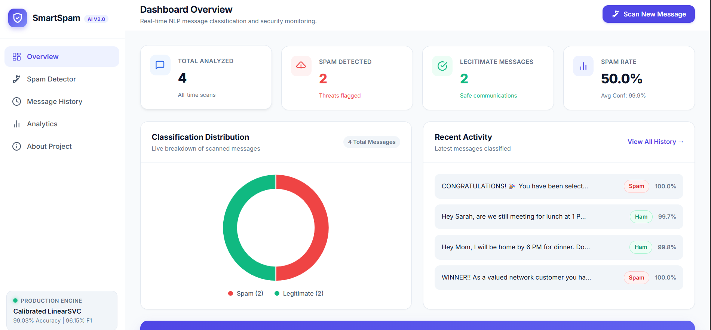
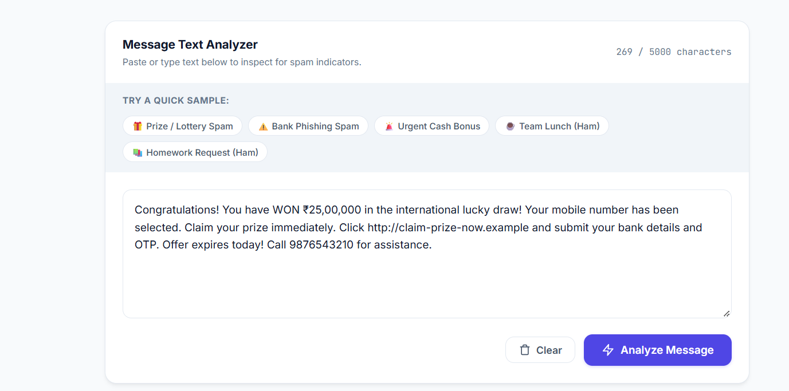
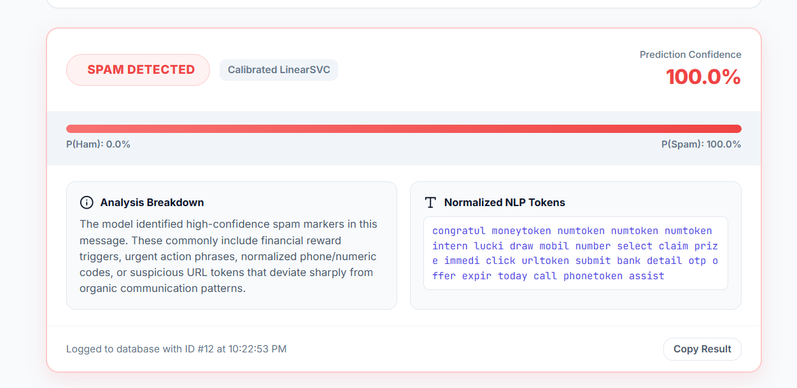
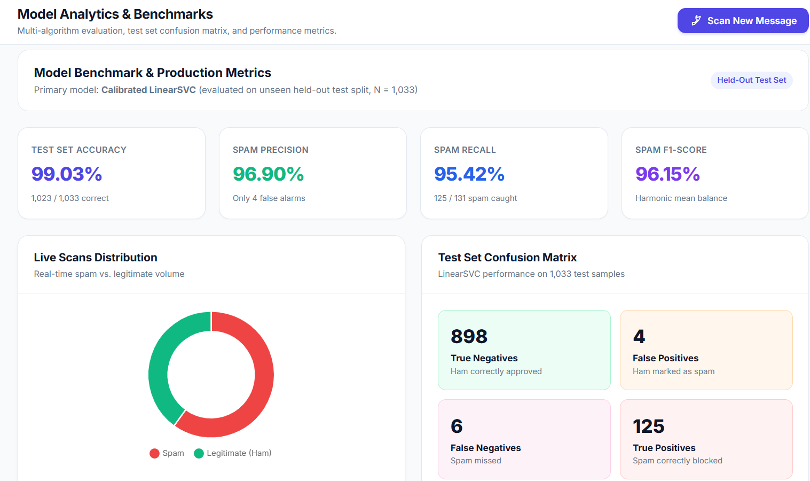
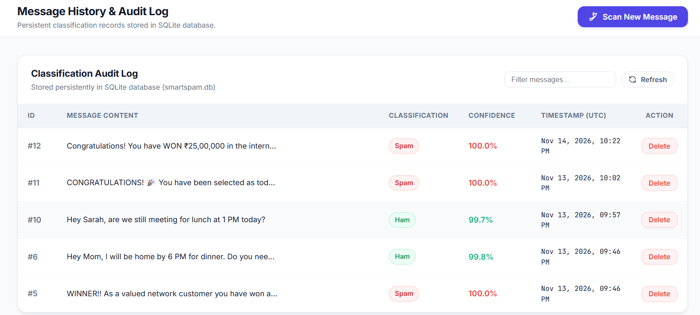

# SmartSpam – AI-Based Spam Classification System


---

## 📖 1. Project Introduction

**SmartSpam** is a full-stack, end-to-end Machine Learning web application designed to identify and classify unsolicited, fraudulent, and potentially malicious text messages.

Developed as an academic Natural Language Processing (NLP) project, SmartSpam combines:

- NLP-based text preprocessing.
- TF-IDF feature extraction.
- Machine Learning classification algorithms.
- Calibrated Linear Support Vector Classification.
- Flask REST API.
- SQLite database for prediction history.
- Interactive web dashboard with real-time analytics.

The application allows users to enter a message and receive a Spam or Ham classification along with a confidence score.

---

## 🎯 2. Problem Statement

Spam and phishing messages have become increasingly common in mobile communication and online services.

These messages may contain fraudulent links, misleading offers, fake rewards, and suspicious contact information.

Detecting spam messages presents several challenges:

1. **Class Imbalance:** Legitimate messages are significantly more common than spam messages.
2. **Text Sparsity:** SMS messages are short and contain limited contextual information.
3. **False Positives:** Incorrectly classifying a legitimate message as spam can cause inconvenience.
4. **Adversarial Obfuscation:** Spammers use unusual punctuation, numbers, URLs, and misspellings to avoid detection.

SmartSpam addresses these challenges using NLP preprocessing and machine learning classification.

---

## 🏆 3. Project Objectives

1. Develop an NLP preprocessing pipeline for cleaning and normalizing text messages.
2. Extract meaningful numerical features using TF-IDF.
3. Train and compare multiple Machine Learning algorithms.
4. Select an effective classification model based on evaluation metrics.
5. Implement a Flask backend with RESTful API endpoints.
6. Store prediction history using SQLite.
7. Develop a responsive dashboard for real-time spam detection and analytics.

---

## 💻 4. Technology Stack

| Layer | Technologies | Purpose |
|---|---|---|
| Frontend | HTML5, CSS3, JavaScript | User interface |
| Visualization | Chart.js 4.4.1 | Dashboard charts and analytics |
| Backend | Python, Flask, Flask-CORS | REST API and application logic |
| NLP | NLTK | Tokenization, stopword removal and stemming |
| Machine Learning | Scikit-learn | Model training and classification |
| Feature Extraction | TF-IDF Vectorizer | Text-to-numerical feature conversion |
| Database | SQLite | Prediction history storage |
| Model Persistence | Pickle, JSON | Saving models and evaluation metrics |

---

## 🏗️ 5. System Architecture

The application follows a client-server architecture.

### Data Flow

```text
        User
         |
         v
   Web Dashboard
 (HTML/CSS/JavaScript)
         |
         v
    Flask REST API
      (app.py)
         |
         v
  Text Preprocessing
  - Lowercase conversion
  - Tokenization
  - URL normalization
  - Phone number normalization
  - Stopword removal
  - Porter stemming
         |
         v
   TF-IDF Vectorizer
         |
         v
  Calibrated LinearSVC
         |
         v
  Spam / Ham Prediction
         |
         +-------------------+
         |                   |
         v                   v
   SQLite Database     Prediction Result
         |                   |
         +---------+---------+
                   |
                   v
             Web Dashboard
```

### Architecture Components

**1. Frontend:** Provides the user interface for entering messages, viewing predictions, checking history and exploring analytics.

**2. Flask Backend:** Receives requests from the frontend, validates input and coordinates the prediction process.

**3. NLP Preprocessing:** Cleans and normalizes the input message before feature extraction.

**4. TF-IDF Vectorizer:** Converts processed text into numerical feature vectors.

**5. Machine Learning Model:** Predicts whether the message belongs to the Spam or Ham category.

**6. SQLite Database:** Stores prediction records for history and analytics.

---

## 📊 6. Dataset Description

SmartSpam uses the **SMS Spam Collection Dataset** from the UCI Machine Learning Repository.

The dataset contains SMS messages categorized into two classes:

- **Ham:** Legitimate messages.
- **Spam:** Unwanted or fraudulent messages.

### Dataset Statistics

| Description | Count |
|---|---:|
| Original Dataset Records | 5,574 |
| Ham Messages (Original) | 4,827 |
| Spam Messages (Original) | 747 |
| Duplicate Records Removed | 403 |
| Additional Empty Records Removed | 6 |
| Final Cleaned Dataset | 5,165 |
| Final Ham Messages | 4,512 |
| Final Spam Messages | 653 |

### Dataset Preparation

The dataset was cleaned by removing duplicate records and messages that became empty after preprocessing.

The cleaned dataset was divided using a stratified train-test split.

| Dataset | Records |
|---|---:|
| Training Set (80%) | 4,132 |
| Testing Set (20%) | 1,033 |

A fixed random state of 42 was used for reproducibility.

---

## 🧹 7. NLP Text Preprocessing

Text preprocessing converts raw messages into a standardized format that can be used by machine learning algorithms.

SmartSpam implements the following preprocessing steps:

### 1. Lowercase Conversion

Converts all text into lowercase to maintain consistency.

Example:

```text
"WIN A FREE PRIZE"
```

Becomes:

```text
"win a free prize"
```

### 2. URL Normalization

URLs are replaced with a common token.

```text
www.example.com → urltoken
```

### 3. Email Normalization

Email addresses are replaced with:

```text
emailtoken
```

### 4. Phone Number Normalization

Phone numbers are replaced with:

```text
phonetoken
```

### 5. Currency and Number Normalization

Currency expressions and numerical values are normalized using:

```text
moneytoken
numtoken
```

### 6. Tokenization

NLTK word tokenization splits a message into individual words or tokens.

### 7. Stopword Removal

Common words that contribute less to classification are removed while preserving important negation words.

### 8. Stemming

Porter Stemmer reduces words to their root forms.

Example:

```text
playing → play
```

These steps help reduce unnecessary variations in the text.

---

## 🔢 8. Feature Extraction Using TF-IDF

Machine learning algorithms require numerical input rather than raw text.

SmartSpam uses **Term Frequency-Inverse Document Frequency (TF-IDF)** to convert processed messages into numerical feature vectors.

### TF-IDF Formula

\[
TFIDF(t,d)=TF(t,d)\times IDF(t)
\]

Where:

- TF = Term Frequency.
- IDF = Inverse Document Frequency.
- t = Term or word.
- d = Document or message.

### Configuration

| Parameter | Value |
|---|---|
| Feature Extraction | TF-IDF |
| N-gram Range | (1, 2) |
| Maximum Features | 4,000 |
| Sublinear TF | True |

Both unigrams (single words) and bigrams (two-word combinations) are considered.

The vectorizer is fitted only on the training dataset to prevent data leakage.

---

## 🤖 9. Machine Learning Algorithms

SmartSpam evaluates multiple classification algorithms to identify the most effective model.

### 1. Multinomial Naive Bayes

A probabilistic classification algorithm based on Bayes' theorem.

It is commonly used for text classification because it works effectively with word-frequency-based features.

### 2. Logistic Regression

A supervised learning algorithm that estimates the probability of a message belonging to a particular class.

### 3. Linear Support Vector Classification (LinearSVC)

A Support Vector Machine-based algorithm that finds an optimal decision boundary between Spam and Ham messages.

SmartSpam uses a calibrated LinearSVC model to obtain confidence estimates.

### Final Model

**Calibrated LinearSVC** was selected as the production model based on its performance on the held-out test dataset.

The model uses sigmoid probability calibration with five-fold cross-validation on the training data.

---

## 📈 10. Model Performance Comparison

All candidate models were evaluated using the same stratified training and testing split.

### Model Comparison

| Algorithm | Accuracy | Spam Precision | Spam Recall | Spam F1-Score |
|---|---:|---:|---:|---:|
| Calibrated LinearSVC | 99.03% | 96.90% | 95.42% | 96.15% |
| MultinomialNB (α = 0.2) | 98.35% | 97.50% | 89.31% | 93.23% |
| MultinomialNB (α = 1.0) | 98.26% | 100.00% | 86.26% | 92.62% |
| Logistic Regression | 97.97% | 97.41% | 86.26% | 91.50% |

### Selected Model

**Calibrated LinearSVC**

Reasons for selection:

- Highest overall accuracy among the evaluated models.
- Strong Spam precision and recall.
- Highest Spam F1-score.
- Effective performance on sparse TF-IDF features.

---

## 📋 11. Model Evaluation

The selected model was evaluated using a confusion matrix and classification metrics.

### Confusion Matrix

| Actual / Predicted | Ham | Spam |
|---|---:|---:|
| Ham | 898 | 4 |
| Spam | 6 | 125 |

### Evaluation Metrics

**Accuracy:** Measures the percentage of correctly classified messages.

**Precision:** Measures how many messages predicted as Spam were actually Spam.

**Recall:** Measures how many actual Spam messages were correctly identified.

**F1-Score:** Represents the harmonic mean of precision and recall.

### Final Evaluation Results

| Metric | Result |
|---|---:|
| Accuracy | 99.03% |
| Spam Precision | 96.90% |
| Spam Recall | 95.42% |
| Spam F1-Score | 96.15% |
| True Negatives | 898 |
| False Positives | 4 |
| False Negatives | 6 |
| True Positives | 125 |

The evaluation results are based on the held-out test dataset and do not represent a guarantee of performance on all real-world messages.

---

## ⚙️ 12. Application Features

### 1. Overview Dashboard

- Displays total predictions.
- Shows Spam and Ham statistics.
- Displays classification distribution.
- Provides recent activity information.

### 2. Spam Detector

- Allows users to enter text messages.
- Performs real-time classification.
- Displays Spam or Ham results.
- Shows prediction confidence.
- Provides quick-test sample messages.

### 3. Message History

- Stores previous predictions.
- Displays classification results.
- Shows confidence scores and timestamps.
- Supports searching and filtering.
- Allows deletion of individual history records.

### 4. Analytics and Benchmarks

- Displays classification statistics.
- Visualizes model performance.
- Shows confusion matrix information.
- Compares different machine learning algorithms.

### 5. About Project

Provides information about the project, its technology stack and implementation.

### 6. Responsive Interface

The application supports desktop, tablet and mobile screen sizes.

---

## 🔌 13. REST API Endpoints

SmartSpam uses Flask REST APIs to communicate between the frontend and backend.

| Method | Endpoint | Description |
|---|---|---|
| POST | `/api/predict` | Classifies an input message |
| GET | `/api/history` | Retrieves prediction history |
| GET | `/api/stats` | Retrieves dashboard statistics |
| DELETE | `/api/history/<id>` | Deletes a history record |
| GET | `/api/health` | Checks backend health |

### Prediction API

**Endpoint:**

```text
POST /api/predict
```

**Request Body:**

```json
{
    "message": "Congratulations! You have won a free prize."
}
```

The backend processes the message, generates a prediction and returns the classification result.

### Input Validation

The API validates:

- JSON request content type.
- Non-empty message input.
- Maximum message length of 5,000 characters.
- Invalid requests and errors.

Structured JSON error responses are used for API failures.

---

## 🗄️ 14. Database Design

SmartSpam uses SQLite to persist prediction history.

### Database

```text
smartspam.db
```

### Table: prediction_history

| Column | Description |
|---|---|
| id | Unique prediction identifier |
| message | Original user message |
| classification | Spam or Ham result |
| confidence | Prediction confidence |
| timestamp | UTC timestamp of prediction |

### Database Features

- Stores prediction history.
- Retrieves previous predictions.
- Supports individual record deletion.
- Maintains data across application restarts.
- Uses parameterized SQL queries.

---

## 📁 15. Project Folder Structure

```text
SmartSpam/
│
├── backend/
│   ├── app.py
│   ├── predictor.py
│   ├── smartspam.db
│   └── test_api.py
│
├── frontend/
│   ├── templates/
│   │   └── index.html
│   │
│   └── static/
│       ├── css/
│       │   └── style.css
│       │
│       └── js/
│           ├── app.js
│           └── charts.js
│
├── ml_pipeline/
│   └── audit_and_compare.py
│
├── screenshots/
│   ├── dashboard.png
│   ├── spam-detector.png
│   ├── prediction-result.png
│   ├── message-history.png
│   └── analytics.png
│
├── requirements.txt
├── README.md
└── .gitignore
```

*The structure above highlights the main project files. Additional model artifacts, datasets and test files may also be present in the repository.*

---

## 🚀 16. Installation and Setup

Follow these steps to run SmartSpam locally.

### Prerequisites

Install the following:

- Python 3.10 or above.
- pip package manager.
- Git (optional, for cloning the repository).

### Step 1: Clone the Repository

```bash
git clone https://github.com/RakeshBasavarajAngadi/SmartSpam.git
```

### Step 2: Navigate to the Project Directory

```bash
cd SmartSpam
```

### Step 3: Create a Virtual Environment

```bash
python -m venv venv
```

### Step 4: Activate the Virtual Environment

For Windows PowerShell:

```powershell
.\venv\Scripts\Activate.ps1
```

### Step 5: Install Dependencies

```bash
pip install -r requirements.txt
```

### Step 6: Run the Application

```bash
python backend/app.py
```

### Step 7: Open the Application

Open your browser and visit:

```text
http://127.0.0.1:5000/
```

The SmartSpam dashboard should now be accessible.

---

## 🧪 17. Testing and Verification

The project includes tests for API functionality, input validation and database persistence.

### Run API Tests

```bash
python backend/test_api.py
```

### Run Edge Case Tests

```bash
python backend/test_edge_cases.py
```

### Run Database Persistence Tests

```bash
python backend/test_database_persistence.py
```

### Run ML Pipeline Evaluation

```bash
python ml_pipeline/audit_and_compare.py
```

### Testing Summary

| Test Category | Reported Result |
|---|---|
| API Tests | 37/37 assertions passed |
| Live Server Tests | 7/7 passed |
| Edge Case Tests | 10/10 passed |
| Database Persistence | Verified across restart |

---

## 🖼️ 18. Application Screenshots

### 1. Overview Dashboard

Real-time dashboard displaying KPIs, classification distribution and recent activity.



### 2. Spam Detector Interface

Interactive message analyzer with character counter and quick-test samples.



### 3. Real-Time Prediction Result

Classification result showing Spam/Ham status and confidence.



### 4. Message History and Audit Log

SQLite-backed message history with classifications, confidence and timestamps.



### 5. Analytics and Model Benchmarks

Model evaluation metrics, confusion matrix and algorithm comparison.



---

## ⚠️ 19. Limitations

Although SmartSpam provides effective SMS spam classification, it has some limitations:

1. **Language Support:** The NLP pipeline is primarily optimized for English messages.
2. **Dataset Dependency:** Model performance depends on the quality and diversity of the training dataset.
3. **Message Length:** The API accepts messages up to 5,000 characters.
4. **Changing Spam Patterns:** New spam techniques may require additional training data and model updates.
5. **Context Understanding:** Traditional machine learning models may not fully understand complex contextual meaning or sarcasm.

---

## 🔮 20. Future Enhancements

The following improvements can be considered in future versions:

- Integrate larger and more diverse spam datasets.
- Support multiple languages.
- Explore advanced NLP models such as BERT.
- Add email spam classification.
- Implement user authentication.
- Deploy the application on a cloud platform.
- Add automatic model retraining.
- Improve detection of suspicious URLs and phishing patterns.

---

## 👨‍💻 21. Project Information

**Project Name:** SmartSpam – AI-Based Spam Classification System

**Project Domain:** Natural Language Processing and Machine Learning

**Project Type:** Full-Stack Machine Learning Web Application

**Developer:** Rakesh Basavaraj Angadi

**GitHub Repository:**

[SmartSpam – GitHub Repository](https://github.com/RakeshBasavarajAngadi/SmartSpam)

---

## 📜 22. Conclusion

SmartSpam demonstrates how Natural Language Processing and Machine Learning can be integrated into a full-stack web application to identify unwanted SMS messages.

The project combines text preprocessing, TF-IDF feature extraction, machine learning classification, REST API development and database integration.

By evaluating multiple classification algorithms, Calibrated LinearSVC was selected as the production model, achieving **99.03% accuracy and a 96.15% Spam F1-score** on the held-out test dataset.

The project provides practical experience in NLP, machine learning, Python backend development, REST APIs, database management and frontend integration.
